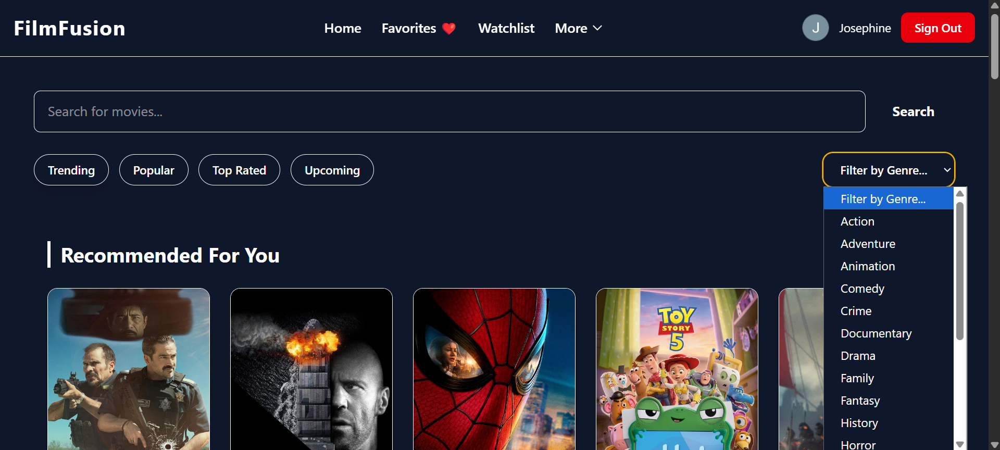
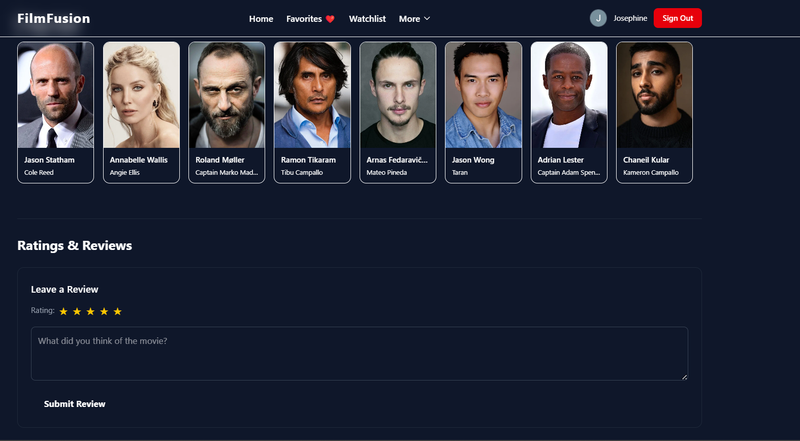

# Film Fusion

Film Fusion is a movie-focused web application I am building to practice React and modern frontend development.

## About

Film Fusion is an interactive movie platform where users can explore movie content and interact with it through features such as favorites and comments.

The project is still under development, with additional features planned.

## Current Features

- Browse and explore movie content
- Add movies to favorites
- User comment sections
- Store and retrieve data using Firebase Firestore
- Interactive movie interface
- Reusable React components
- Responsive styling with Tailwind CSS

## Planned Features

- Blog posts and movie-related articles
- Additional improvements to the user experience
- More interactive features

## Technologies Used

- React
- JavaScript
- Tailwind CSS
- Firebase
- Firestore

## Data & Content

Movie-related information and/or content used in this project is sourced from IMDb.

## What I Learned

Through this project, I have been practicing:

- Building reusable interfaces with React components
- Creating interactive features with JavaScript
- Working with Firebase and Firestore
- Styling interfaces with Tailwind CSS
- Organizing a larger frontend project
- Building features that allow users to interact with content

## Project Status

**In Development**

## Preview

### Home

### Movie details

### Ratings

